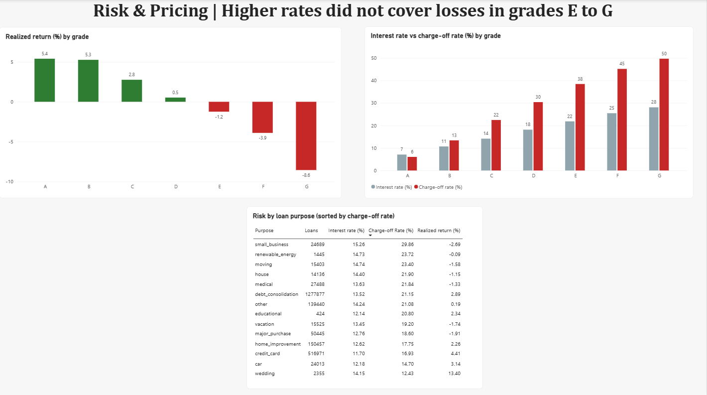
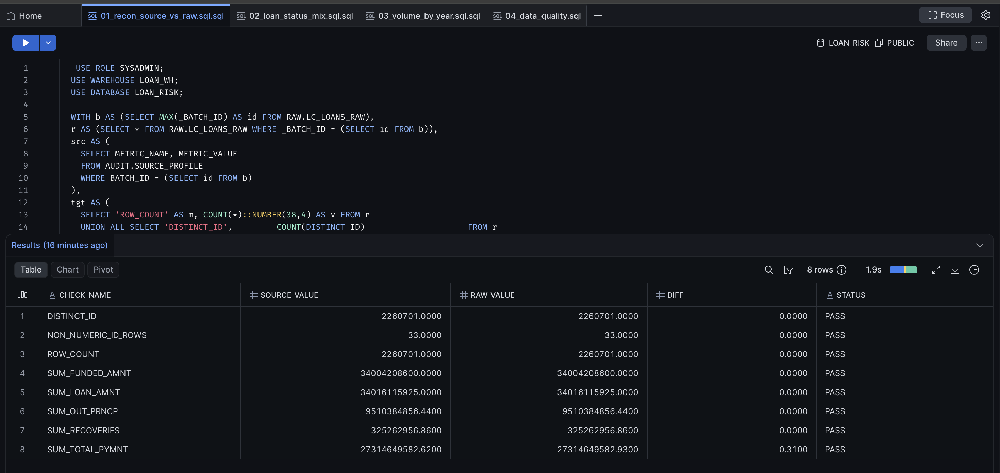
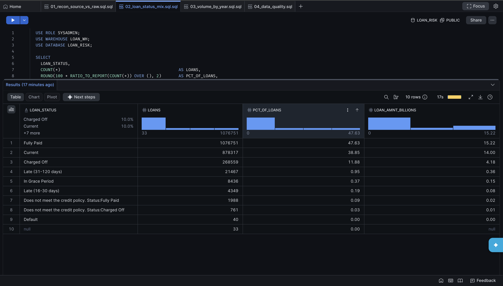
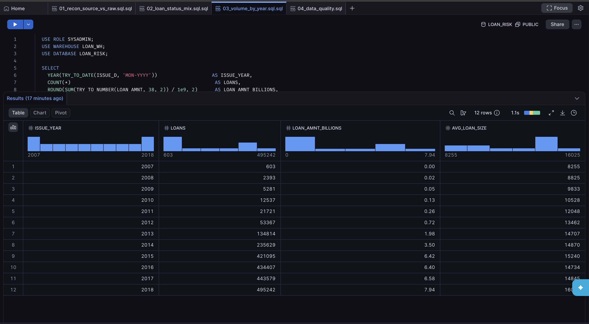
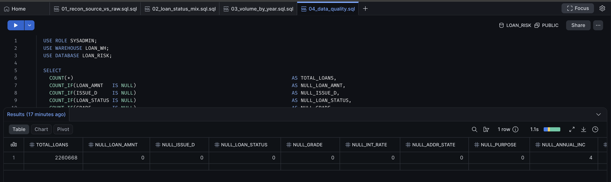
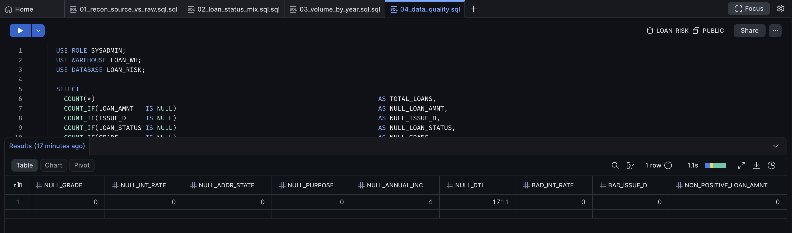
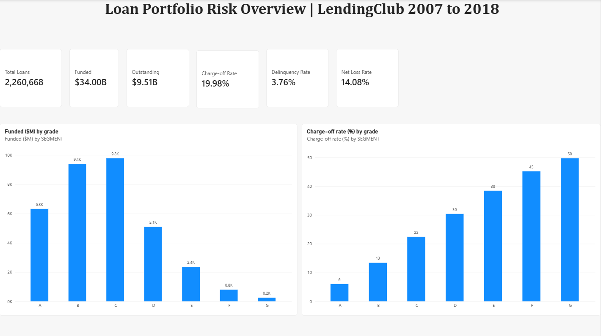
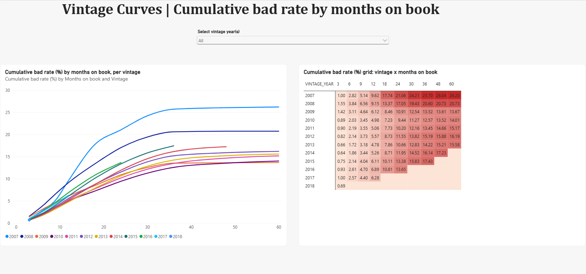
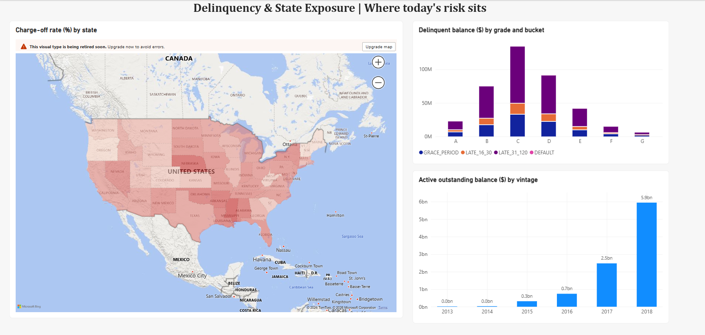

# Loan Portfolio Risk & Delinquency Analytics

LendingClub accepted loans, 2007–2018Q4 → Snowflake (RAW → STAGING → MARTS) → Power BI.

**2.26M loans · $34.0B funded · 16/16 reconciliation controls PASS · 4-page Power BI risk dashboard**

**Key finding:** grades E to G (189,607 loans, $3.41B) charged off at 38% to 50% and lost money despite 22% to 28% interest rates, while the portfolio charged off at 19.98%.



**Stack:** Snowflake · SQL · Python (pandas) · Power BI (DAX) · GitHub

## Step 1: Download + RAW layer

### Prerequisites
- Snowflake account
- Kaggle API credentials in `~/.kaggle/`
- Python 3.9+
- Snowflake service user with key-pair auth: `sql/00b_service_user.sql`

```bash
python -m venv .venv && source .venv/bin/activate
pip install -r requirements.txt
cp .env.example .env                                  # fill in your Snowflake details
```

### Run order

| # | What | Where |
|---|------|-------|
| 1 | `python scripts/01_download.py` | terminal: pulls ~1.6 GB from Kaggle |
| 2 | `sql/00_setup.sql`, then `sql/00b_service_user.sql` | Snowflake worksheet: warehouse, DB, schemas, file format, stage, audit tables; pipeline service user |
| 3 | `python scripts/02_profile_source.py` | terminal: profiles the CSV *before* load (source side of reconciliation) |
| 4 | `python scripts/03_load_raw.py` | terminal: generates DDL, PUTs file, COPYs into `RAW.LC_LOANS_RAW`, logs to `AUDIT` |
| 5 | `sql/01_raw_checks.sql` | Snowflake worksheet: source-vs-RAW reconciliation, status mix, yearly volume, data quality |

### Step 1 results
| Check | Result |
|---|---|
| Rows in source file / loaded to RAW | 2,260,701 / 2,260,701 (0 COPY errors) |
| Real loans (excl. 33 LendingClub summary rows) | 2,260,668 |
| Total loan amount | $34.02B (Jun 2007 – Dec 2018) |
| Source-vs-RAW reconciliation | 8/8 PASS; only variance $0.31 on $27.3B total payments (float vs exact decimal) |
| Duplicate loan ids | 0 |
| Nulls on key columns | 0, except DTI 1,711 and annual income 4 |
| Resolved-loan charge-off rate | 19.96% on standard statuses (268,559 of 1,345,310); 19.98% once "does not meet credit policy" loans are folded in (see Step 2) |

**Source vs RAW reconciliation (8/8 PASS)**


**Loan status mix**


**Volume by origination year**


**Data quality on key columns**



### Design choices
- **RAW is all VARCHAR.** No type casting at load, so nothing gets silently dropped or coerced. Typing happens in STAGING, where bad values are counted, not lost.
- **Lineage columns** on every row: `_BATCH_ID`, `_SOURCE_FILE`, `_SOURCE_ROW_NUMBER`, `_LOADED_AT`.
- **Source profile captured independently** (pandas, outside Snowflake) and stored in `AUDIT.SOURCE_PROFILE`, so Step 2 reconciliation compares two independent counts, not Snowflake against itself.
- **Key-pair auth** via a dedicated `TYPE = SERVICE` user; no passwords in code or config.
- **COPY results logged** to `AUDIT.LOAD_LOG` (rows parsed, rows loaded, errors).

### How Snowflake is used
| Need | Snowflake feature |
|---|---|
| Upload the 393 MB source file | Internal stage `@RAW.STG_LC` + `PUT` |
| Bulk load 2,260,701 rows, 0 errors, result logged | `COPY INTO` with a named file format and `ON_ERROR = CONTINUE` |
| Row-level lineage | `METADATA$FILENAME`, `METADATA$FILE_ROW_NUMBER` |
| Compute | X-Small virtual warehouse `LOAN_WH`, auto-suspend after 60 seconds, auto-resume |
| Layered model | `LOAN_RISK` database with `RAW`, `STAGING`, `MARTS`, `AUDIT` schemas |
| Dashboard layer | Views: `VW_PORTFOLIO_KPIS`, `VW_RISK_BY_SEGMENT`, `VW_VINTAGE_CURVES`, `VW_DELINQUENCY_BUCKETS`, `VW_RISK_BY_STATE` |
| Pipeline security | `TYPE = SERVICE` user with RSA key-pair authentication |
| Snowflake SQL features | `TRY_TO_NUMBER` / `TRY_TO_DATE` (safe casting), `QUALIFY` (dedupe), `IFF`, `COUNT_IF`, `GENERATOR` (calendar), `PIVOT`, `GROUPING SETS`, `RATIO_TO_REPORT` |

## Step 2: STAGING + star schema + end-to-end reconciliation

| # | File | What it builds |
|---|------|----------------|
| 1 | `sql/02_staging.sql` | `STAGING.STG_LOANS`: typed and cleaned, 33 junk rows excluded, deduped on loan id, 10 raw statuses mapped to 7 risk groups, risk flags (`IS_RESOLVED`, `IS_BAD`, `IS_DELINQUENT`, `IS_30PLUS_DPD`), gross and net charge-off amounts |
| 2 | `sql/03_marts.sql` | `MARTS.DIM_DATE` (daily calendar 2007 to 2020), `MARTS.DIM_BORROWER` (borrower profile at origination with FICO, income, DTI and tenure bands), `MARTS.FCT_LOAN` (one row per loan, keys to both dimensions) |
| 3 | `sql/04_recon.sql` | 16 PASS/FAIL controls SOURCE → RAW → STAGING → MARTS, written to `AUDIT.RECON_RESULTS` |

### Step 2 results
| Check | Result |
|---|---|
| Loans in STAGING and FCT_LOAN | 2,260,668 (unique, 0 duplicates) |
| Loan amount carried through every layer | $34,016,115,925 (exact match) |
| Net charge-offs (after recoveries net of fees) | $2.73B |
| Unmapped loan statuses | 0 |
| Orphan keys (borrower, issue date) | 0 / 0 |
| End-to-end reconciliation | **16/16 PASS** |
| Resolved-loan charge-off rate | 19.98% (269,320 of 1,348,059) |
| Calendar dimension (DIM_DATE) | 5,114 days, 2007-01-01 to 2020-12-31, 168 months, unique keys |

**Loans by status group (STAGING)**
| Status group | Loans | Loan amount ($B) | Net charge-off ($M) |
|---|---|---|---|
| Fully Paid | 1,078,739 | 15.237 | 0.0 |
| Current | 878,317 | 14.003 | 0.0 |
| Charged Off | 269,320 | 4.187 | 2,733.4 |
| Late (31 to 120 days) | 21,467 | 0.364 | 0.0 |
| In Grace Period | 8,436 | 0.149 | 0.0 |
| Late (16 to 30 days) | 4,349 | 0.076 | 0.0 |
| Default | 40 | 0.001 | 0.4 |
| **Total** | **2,260,668** | **34.016** | **2,733.8** |

**Reconciliation controls (all PASS):** row counts and balance totals at every hop (Source → RAW → STAGING → MARTS), junk rows excluded (33), unmapped statuses (0), duplicate loan ids (0), orphan borrower and date keys (0). Full detail: [`results/09_recon_all_layers.csv`](results/09_recon_all_layers.csv).

Query outputs for Steps 2 to 4 are exported as CSVs in [`results/`](results/); Step 1 outputs are shown as screenshots above.

**Charge-off rate by FICO band (resolved loans)**
| FICO band | Borrowers | Charge-off rate |
|---|---|---|
| Under 660 | 489 | 30.88% |
| 660 to 699 | 1,304,313 | 23.60% |
| 700 to 739 | 673,794 | 16.08% |
| 740+ | 282,072 | 9.65% |

The 660 to 699 band holds 58% of borrowers and charges off at 2.4x the rate of 740+.

**Note on the borrower dimension:** LendingClub anonymizes member ids, so `DIM_BORROWER` is the borrower profile at origination, 1:1 with the loan.

## Step 3: Risk KPIs, segment pricing, vintage curves

`sql/05_kpis.sql` builds three views in MARTS for the dashboard layer: `VW_PORTFOLIO_KPIS`, `VW_RISK_BY_SEGMENT`, `VW_VINTAGE_CURVES`.

**KPI definitions**
| KPI | Definition |
|---|---|
| Charge-off rate | Charged-off loans / resolved loans (Fully Paid + Charged Off) |
| Delinquency rate | Grace, late and default loans / active loans |
| 30+ DPD rate | Loans 31+ days past due or in default / active loans |
| Net loss rate | Net charge-offs / funded amount, resolved loans |
| Recovery rate | Recoveries / gross charge-offs |
| Realized return | (Total paid - funded) / funded, resolved loans, lifetime (not annualized) |

### Portfolio KPIs
| KPI | Value |
|---|---|
| Loans / funded | 2,260,668 / $34.0B |
| Outstanding principal (912,609 active loans) | $9.51B |
| Charge-off rate | 19.98% |
| Delinquency rate / 30+ DPD rate | 3.76% / 2.36% |
| Gross / net charge-offs | $3.005B / $2.734B |
| Recovery rate | 10.82% ($325.3M) |
| Net loss rate | 14.08% |
| Average interest rate | 13.09% |

### Key insight: higher pricing did not cover losses in grades E to G
| Grade | Avg rate | Charge-off rate | Realized return |
|---|---|---|---|
| A | 7.08% | 6.04% | +5.40% |
| B | 10.68% | 13.39% | +5.26% |
| C | 14.14% | 22.44% | +2.76% |
| D | 18.14% | 30.38% | +0.53% |
| E | 21.83% | 38.43% | -1.24% |
| F | 25.45% | 45.14% | -3.90% |
| G | 28.07% | 49.67% | -8.56% |
| Portfolio | 13.09% | 19.98% | +2.86% |

- Grades E to G (189,607 loans, $3.41B funded) charged off at 38% to 50% and returned a loss despite 22% to 28% rates.
- Small business loans charged off at 29.86% (1.5x the portfolio) while priced at 15.26%, close to grade C, returning -2.69%.
- 60-month loans charged off at 2x the rate of 36-month loans (32.45% vs 16.02%).

Caveat: realized return uses resolved loans only, which skews recent vintages toward early defaults. Vintage curves below compare loans at the same age.

### Vintage curves: cumulative bad rate by months on book
| Vintage | 6 | 12 | 18 | 24 | 36 | 48 | 60 |
|---|---|---|---|---|---|---|---|
| 2007 | 2.82 | 9.62 | 17.74 | 21.06 | 25.70 | 26.04 | 26.20 |
| 2008 | 3.84 | 9.15 | 13.37 | 17.05 | 20.60 | 20.73 | 20.73 |
| 2009 | 3.11 | 6.12 | 8.46 | 10.91 | 13.52 | 13.61 | 13.67 |
| 2010 | 2.03 | 4.98 | 7.23 | 9.44 | 12.57 | 13.52 | 14.01 |
| 2011 | 2.19 | 5.06 | 7.73 | 10.20 | 13.45 | 14.66 | 15.17 |
| 2012 | 2.14 | 5.57 | 8.73 | 11.55 | 15.19 | 15.88 | 16.19 |
| 2013 | 1.72 | 4.78 | 7.86 | 10.66 | 14.22 | 15.21 | 15.58 |
| 2014 | 1.86 | 5.26 | 8.71 | 11.95 | 16.14 | 17.23 | |
| 2015 | 2.14 | 6.11 | 10.11 | 13.38 | 17.43 | | |
| 2016 | 2.61 | 6.89 | 10.81 | 13.65 | | | |
| 2017 | 2.57 | 6.28 | | | | | |

Default timing uses months from issue to last payment. A point is shown only when the whole vintage has reached that age by the data snapshot.

**Full Step 3 outputs:** [`results/10_portfolio_kpis.csv`](results/10_portfolio_kpis.csv), [`results/11_risk_by_segment.csv`](results/11_risk_by_segment.csv) (all 24 segments incl. every loan purpose), [`results/12_vintage_curves.csv`](results/12_vintage_curves.csv).

- 2007 to 2008 (crisis era) were the worst vintages: 21% to 26% bad by 36 months.
- 2009 to 2011 were the cleanest (about 13% by 36 months).
- Credit then loosened during the growth years: at 36 months, the 2015 vintage (17.43%) ran 39% worse than 2010 (12.57%).

## Step 4: Delinquency buckets on the active book

`sql/06_delinquency.sql` builds `MARTS.VW_DELINQUENCY_BUCKETS`: the 912,609 active loans split by late-payment bucket (Current, Grace, Late 16 to 30, Late 31 to 120, Default), by grade and vintage.

The dataset is a single snapshot of each loan's status, not monthly history, so true roll rates (Current to 30 to 60 days) cannot be computed. This bucket view is the snapshot equivalent.

### By grade (share of outstanding balance)
| Grade | Active loans | Outstanding ($M) | Current | Grace | Late 16 to 30 | Late 31 to 120 | Delinquent balance |
|---|---|---|---|---|---|---|---|
| A | 197,839 | 2,002.7 | 98.88% | 0.31% | 0.16% | 0.65% | 1.12% |
| B | 270,462 | 2,676.0 | 97.21% | 0.63% | 0.36% | 1.80% | 2.79% |
| C | 267,738 | 2,847.3 | 95.29% | 1.14% | 0.58% | 2.99% | 4.71% |
| D | 122,780 | 1,368.7 | 93.34% | 1.60% | 0.83% | 4.22% | 6.66% |
| E | 41,453 | 455.4 | 90.88% | 2.05% | 1.09% | 5.96% | 9.12% |
| F | 9,495 | 120.2 | 87.82% | 2.86% | 1.45% | 7.86% | 12.18% |
| G | 2,842 | 40.2 | 85.35% | 3.78% | 1.60% | 9.27% | 14.65% |
| **All** | **912,609** | **9,510.4** | **95.96%** | **0.97%** | **0.50%** | **2.57%** | **4.04%** |

### By vintage
| Vintage | Active loans | Outstanding ($M) | Delinquent balance | 30+ DPD balance |
|---|---|---|---|---|
| 2014 | 12,527 | 31.2 | 6.39% | 3.72% |
| 2015 | 45,550 | 314.7 | 5.60% | 3.47% |
| 2016 | 141,312 | 740.8 | 6.44% | 4.16% |
| 2017 | 274,279 | 2,477.2 | 5.56% | 3.63% |
| 2018 | 438,931 | 5,946.5 | 3.02% | 1.88% |
| **All** | **912,609** | **9,510.4** | **4.04%** | **2.57%** |

(2013 has 10 active loans and is omitted.)

- About $384M (4.04%) of the $9.51B active book is delinquent; $244M is already 31 to 120 days late.
- Delinquent balance rises 13x from grade A (1.12%) to grade G (14.65%), the same ordering as charge-offs.
- Across every grade, about 64% of delinquent balance is already in the 31 to 120 day bucket: once loans slip, most go deep, so collections need to act in the grace and 16 to 30 day window.
- 89% of the active balance ($8.4B) is in the 2017 and 2018 vintages. 2018 looks cleanest (3.02%) only because it is young; seasoned vintages run 5.6% to 6.4%, so 2018 delinquency should rise as it ages.

**Full outputs:** [`results/13_delinquency_by_grade.csv`](results/13_delinquency_by_grade.csv), [`results/13_delinquency_by_vintage.csv`](results/13_delinquency_by_vintage.csv).

## Step 5: Power BI dashboard

The dashboard reads five curated MARTS views, exported as CSV extracts by `sql/08_powerbi_exports.sql` (the state view is built in `sql/07_powerbi_views.sql`).

| File | Contents |
|---|---|
| [`powerbi_data/Lending_Club_Risk_Dashboard.pbix`](powerbi_data/Lending_Club_Risk_Dashboard.pbix) | Power BI Desktop report |
| [`powerbi_data/Lending_Club_Risk_Dashboard.pdf`](powerbi_data/Lending_Club_Risk_Dashboard.pdf) | PDF export of all 4 pages |
| `powerbi_data/pbi_*.csv` | Extracts: portfolio KPIs (1 row), risk by segment (24), vintage curves (98), delinquency buckets (162), risk by state (51) |

**Build notes**
- Five independent summary tables with no relationships, so no cross-filtering between unrelated grains.
- KPI cards driven by DAX measures for display formatting, e.g. `Funded = FORMAT(SUM(pbi_portfolio_kpis[FUNDED_AMNT]) / 1000000000, "$0.00") & "B"`.
- Conditional formatting: realized return colored red below zero and green above; vintage grid and state map shaded on a white-to-red gradient.
- Delinquency buckets sorted by a `BUCKET_ORDER` column (Current → Grace → 16 to 30 → 31 to 120 → Default) rather than alphabetically.
- State column categorized as State or Province; AK and HI hidden from the map only so the lower 48 frame correctly.

### Page 1: Portfolio Overview
Six KPI cards (2,260,668 loans · $34.00B funded · $9.51B outstanding · 19.98% charge-off · 3.76% delinquency · 14.08% net loss) with funded amount and charge-off rate by grade.



### Page 2: Risk & Pricing
Realized return by grade (E to G negative), interest rate vs charge-off rate by grade, and a loan-purpose table sorted by charge-off rate (small business highest at 29.86%).


### Page 3: Vintage Curves
Cumulative bad rate by months on book, one line per origination year, with a vintage selector and a vintage × month heatmap.



### Page 4: Delinquency & States
Charge-off rate by state (filled map), delinquent balance by grade and bucket, and active outstanding balance by vintage.



## Project layout
```
scripts/   Python: download, profile, load, shared Snowflake connection
sql/       Snowflake setup, RAW checks, staging, star schema, reconciliation, KPI views, Power BI extracts
powerbi_data/  Power BI report (.pbix, .pdf) and the CSV extracts it reads
results/   CSV exports of query outputs (Steps 2 to 4)
images/    Step 1 result screenshots and dashboard pages
data/      local data (git-ignored)
```
